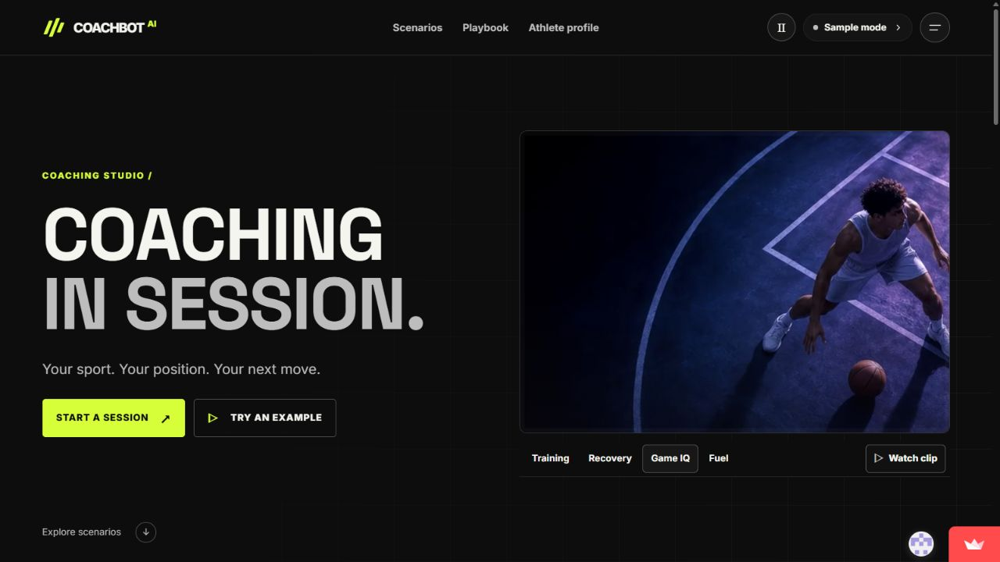
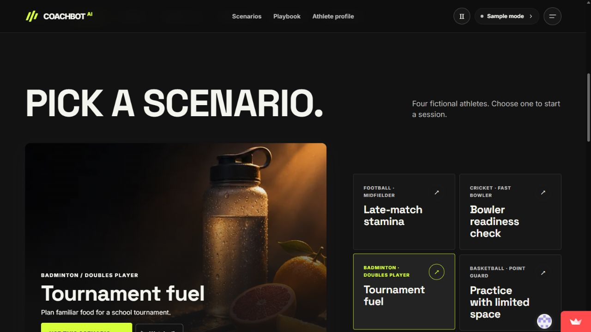
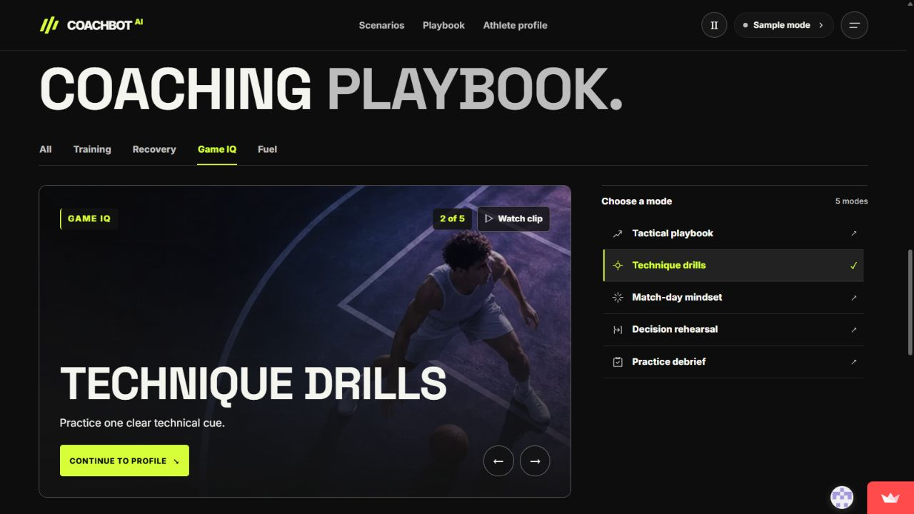
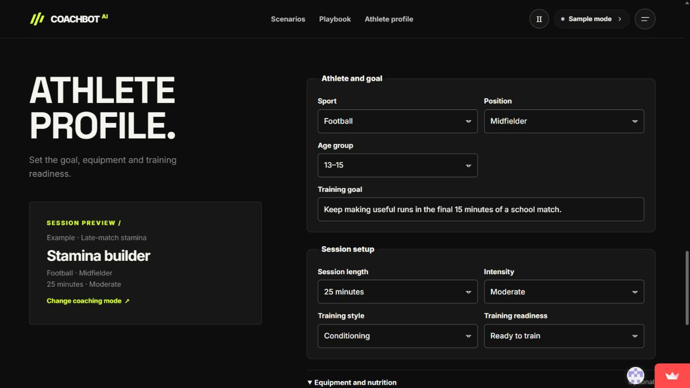
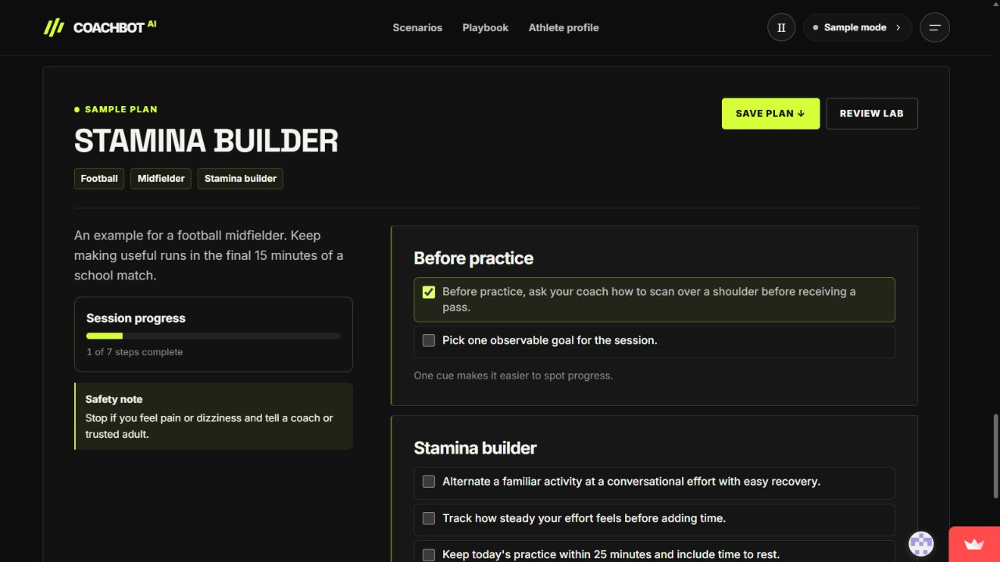
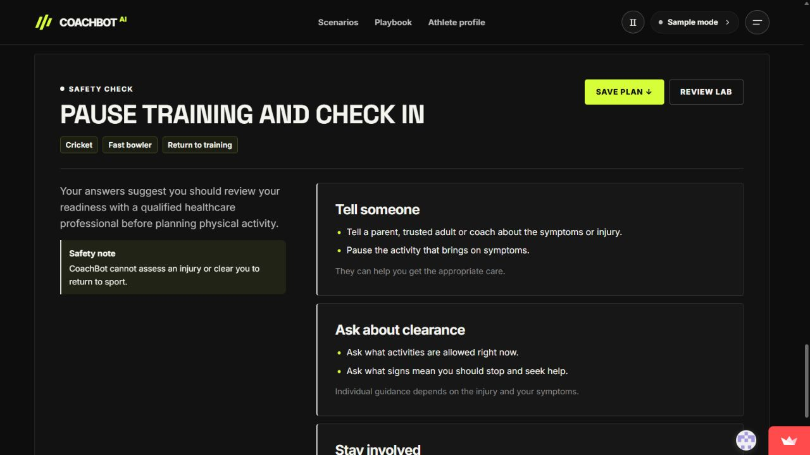
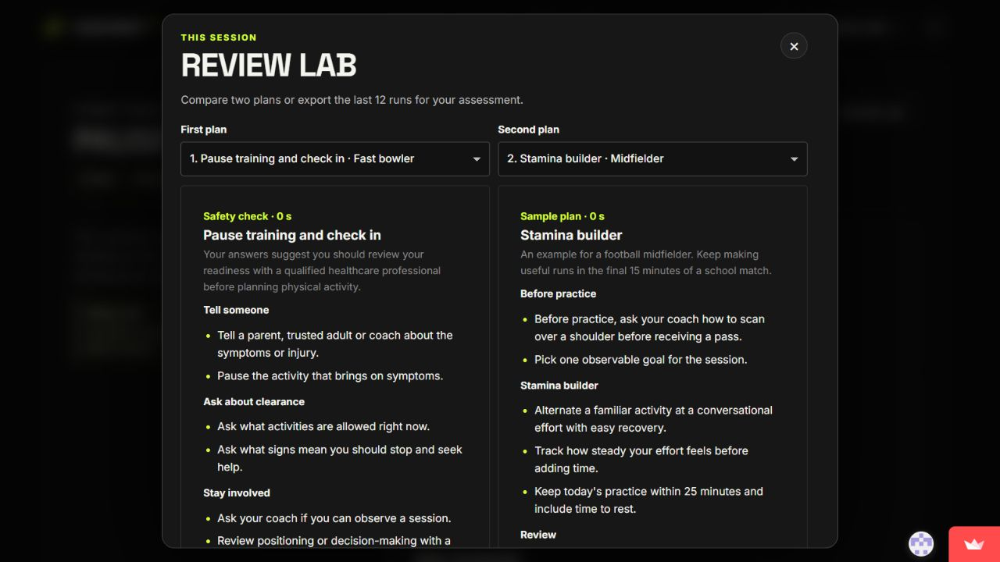
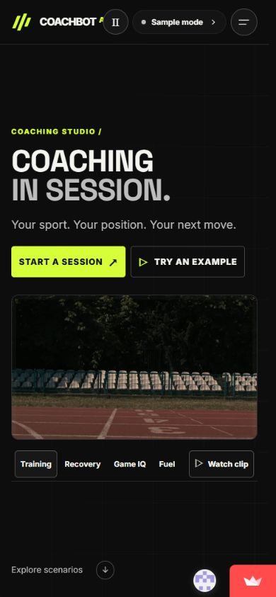
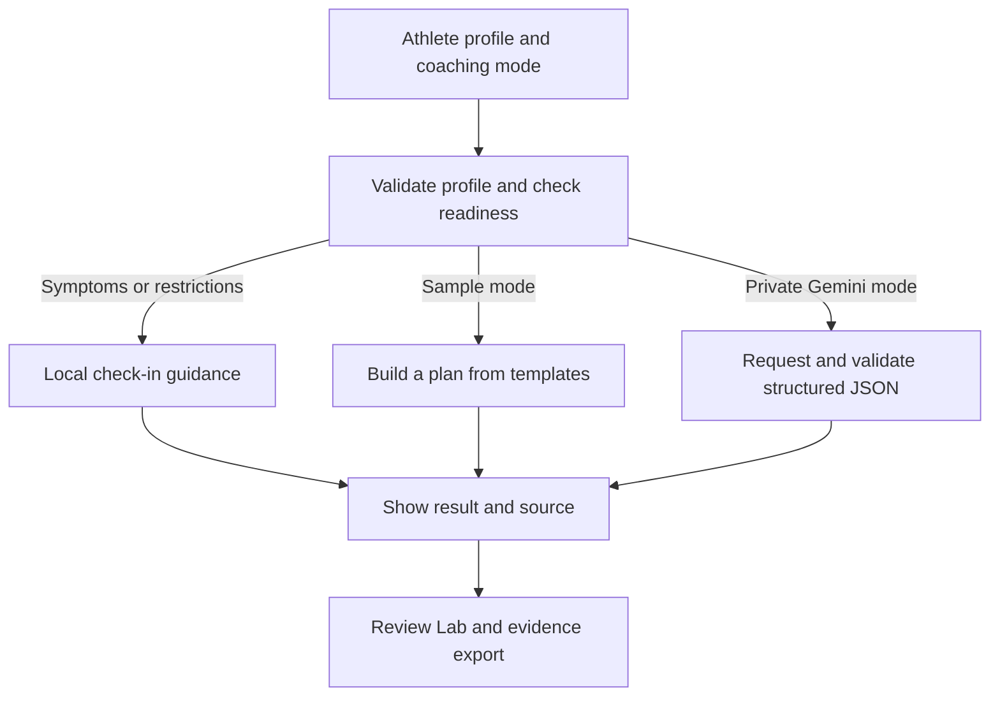

# CoachBot AI

[](https://coachbotai.streamlit.app/)

CoachBot turns a fictional athlete’s sport, position, goal, and available equipment into a coaching plan with practical steps. The training studio covers **6 sports, 26 positions, and 13 coaching modes**.

**Sritharan N S · Jain Vidyalaya IB World School**  
CRS Artificial Intelligence · Generative AI Summative Assessment 3 · Scenario 2

[Open the live app](https://coachbotai.streamlit.app/) · [See the screenshots](#screenshots) · [Run locally](#run-locally) · [Read the assessment storyboard](docs/CoachBot_AI_Storyboard.pdf)

## Try the demo

1. Choose **Try an example**. CoachBot fills in a football midfielder’s profile and the late-match stamina goal.
2. Select **Generate session**. Check off a step to update the progress bar or choose **Save plan** for a text copy.
3. Open **Scenarios**, select **Bowler readiness check**, and choose **Use this scenario**. Generate the readiness result. Open **Review Lab** to compare the two runs and export evidence as JSON.

The public classroom app uses built-in sample plans and includes the local readiness checks. Each result shows its source. Review Lab retains up to 12 runs in the current session, and step checkmarks belong to the plan currently on screen.

## Screenshots

These captures show the current Streamlit app using fictional profiles. Select an image to see it at full size.

<table>
  <tr>
    <td width="50%"><strong>Training studio</strong><br>Switch sports clips or start a session.<br><a href="docs/screenshots/home.jpg"></a></td>
    <td width="50%"><strong>Scenario gallery</strong><br>Preview an athlete and goal before loading the case.<br><a href="docs/screenshots/scenarios.jpg"></a></td>
  </tr>
  <tr>
    <td><strong>Coaching Playbook</strong><br>Filter modes by category and preview the selected mode.<br><a href="docs/screenshots/playbook.jpg"></a></td>
    <td><strong>Athlete profile</strong><br>See the session preview alongside the athlete and goal fields.<br><a href="docs/screenshots/builder.jpg"></a></td>
  </tr>
  <tr>
    <td><strong>Generated session</strong><br>Work through the checklist and track progress.<br><a href="docs/screenshots/plan.jpg"></a></td>
    <td><strong>Readiness guidance</strong><br>See the local check-in response for the fictional fast-bowler case.<br><a href="docs/screenshots/readiness.jpg"></a></td>
  </tr>
  <tr>
    <td valign="top"><strong>Review Lab</strong><br>Compare the sample plan and the readiness result side by side.<br><a href="docs/screenshots/review.jpg"></a></td>
    <td valign="top"><strong>Mobile · 390 px</strong><br>The landing page, clip controls, and menu fit a phone viewport.<br><a href="docs/screenshots/mobile.jpg"></a></td>
  </tr>
</table>

## Coaching Playbook

| Category | Modes |
| --- | --- |
| Training | Position workout, Stamina builder, Warm-up & cooldown, Small-space practice |
| Recovery | Return to training, Mobility routine |
| Game IQ | Tactical playbook, Technique drills, Match-day mindset, Decision rehearsal, Practice debrief |
| Fuel | Sports nutrition, Hydration routine |

Sports include football, cricket, basketball, athletics, volleyball, and badminton. The position catalog, mode instructions, and sample templates are in [coach.py](coach.py).

## How it works



The readiness check runs before model selection. For the private Gemini demo, CoachBot validates the returned title, summary, steps, and safety note. An eligible provider error can trigger one retry with a distinct backup key.

| Source | Purpose |
| --- | --- |
| [app.py](app.py) | Streamlit entry point, component events, model settings, and session history |
| [coach.py](coach.py) | Profile validation, readiness rules, sample templates, and Gemini calls |
| [styles.css](styles.css) | Editable color and type tokens, Streamlit shell styles, and responsive component styles |
| [web/](web/) | Interface markup and interactions for previews, profiles, plans, and Review Lab |
| [static/](static/) | Four sports clips and their poster frames |
| [.streamlit/config.toml](.streamlit/config.toml) | Dark theme and static media serving |
| [tests/](tests/) | Coaching logic, mocked provider responses, and Streamlit session tests |

## Run locally

Install Python, then run these commands from the repository folder.

```bash
python -m pip install -r requirements.txt
python -m streamlit run app.py --server.address 127.0.0.1
```

Open the local URL shown in the terminal. On Windows, [Launch-CoachBot.cmd](Launch-CoachBot.cmd) also starts the app after the requirements are installed. The sample workflow is ready to use on startup.

For Streamlit Community Cloud, deploy `app.py` from `main`. The public app uses the default sample-mode configuration. [Live CoachBot app](https://coachbotai.streamlit.app/)

## Private Gemini demo

Google’s Gemini API terms limit API use to adults and restrict use in apps directed at under-18s. Live integration is intended for a private, adult-operated assessment demo with fictional profiles. [Gemini API Additional Terms](https://aistudio.google.com/docs/terms#age-requirements)

1. Use [.streamlit/secrets.toml.example](.streamlit/secrets.toml.example) as a template and set `COACHBOT_ADULT_DEMO = "true"` for the private demo. Place the settings in the ignored `.streamlit/secrets.toml` file locally or in the private app’s Streamlit Cloud Secrets.
2. Create the key in [Google AI Studio](https://aistudio.google.com/api-keys). Save it as `GEMINI_API_KEY` in Secrets or enter it in **Model settings** for the current browser session. `GEMINI_API_KEY_BACKUP` is optional and takes a distinct key.
3. Choose **Test Gemini**. CoachBot sends a built-in fictional football profile. A successful response shows **Gemini · Primary** or **Gemini · Backup**, the model, and elapsed time.

| Model in the configuration | Review Lab comparison control |
| --- | --- |
| `gemini-3.8-flash` (default) | Low or medium reasoning |
| `gemini-2.5-flash-lite` | Temperature 0.3, 0.5, or 0.7 with top-p set to 0.9 |

For an assessment comparison, keep the fictional profile and mode fixed, change one supported setting, and compare how well each result fits the position and the stated constraints. [Gemini model reference](https://aistudio.google.com/docs/models)

## Validation

```bash
python -m unittest discover -s tests -v
```

The automated suite covers all **338 position-and-mode combinations** in sample mode, invalid inputs, readiness routing, Gemini response validation, backup-key retries, and Streamlit session events. The screenshots document the live sample workflow, the readiness result, run comparison, and the 390 px layout. Provider responses in the tests are mocked. **Test Gemini** checks provider access in the private demo.

## Design and research

The editorial theme uses Space Grotesk headlines, Inter body text, a near-black canvas, and one lime accent. Edit `--cb-accent` at the top of [styles.css](styles.css) to change the UI accent. The app includes a pause control and honors the device’s reduced-motion preference. The animated banner uses the same four clips as the app. [Design reference](https://madetodisrupt.com/)

- Training intensity, recovery, and supervision informed the athlete profile and coaching prompts. [IOC consensus on youth athletic development](https://doi.org/10.1136/bjsports-2015-094962)
- The training templates emphasize supervised, age-appropriate progression. [Youth resistance training consensus](https://doi.org/10.1136/bjsports-2013-092952)
- A possible concussion in a fictional profile triggers a local check-in response. [CDC HEADS UP](https://www.cdc.gov/heads-up/guidelines/returning-to-sports.html)
