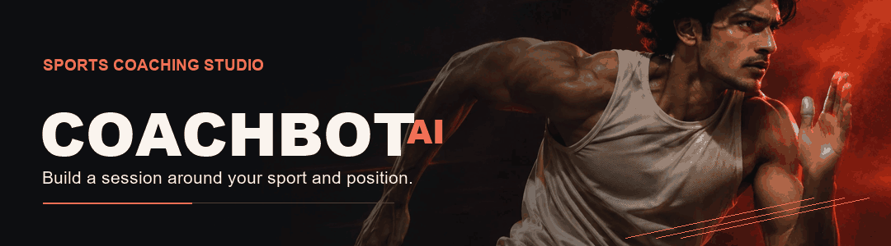
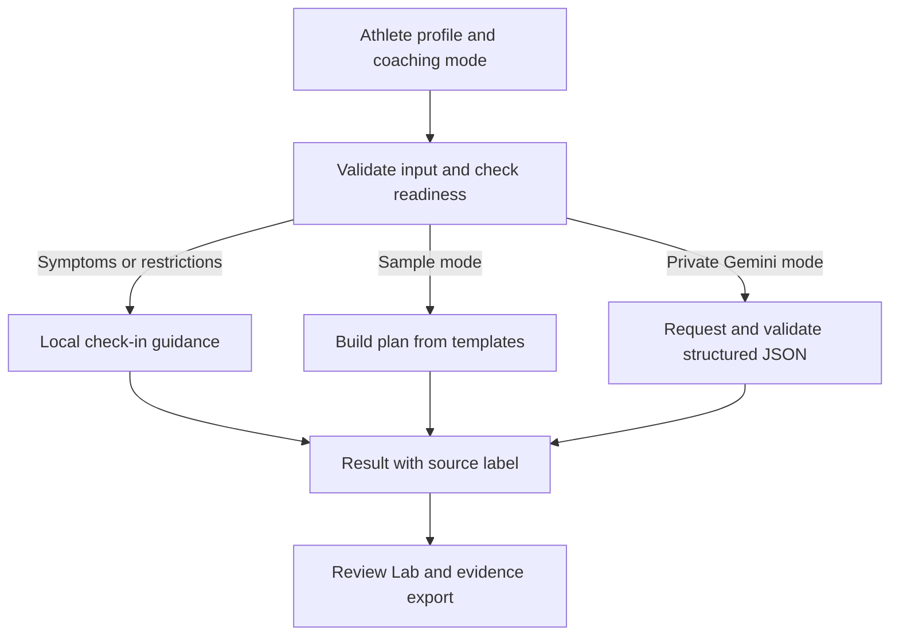

# CoachBot AI



**CRS Artificial Intelligence · Generative AI Summative Assessment 3 · Scenario 2**  
Sritharan N S · Jain Vidyalaya IB World School

[Open CoachBot](https://coachbotai.streamlit.app/) · [Try the demo](#try-the-demo) · [Run locally](#run-locally) · [Model setup](#model-configuration-and-comparison) · [Storyboard PDF](docs/CoachBot_AI_Storyboard.pdf)

CoachBot turns a fictional athlete's sport, position, goal and available equipment into a coaching session. The prototype covers **six sports, 26 positions and 13 coaching modes**. Browse the video previews, work through the generated steps, and compare your runs in Review Lab.

## Try the demo

1. Open the [public Streamlit app](https://coachbotai.streamlit.app/) and choose **Try an example**. CoachBot fills in a football midfielder's profile and stamina goal.
2. Select **Generate session**. Check off individual steps as you read through the plan. **Save plan** downloads a text copy.
3. Open **Scenarios**, select **Bowler readiness check**, and choose **Use this scenario**. Generate a second run. **Review Lab** shows the two outputs side by side and exports run evidence as JSON.

The public demo generates built-in sample plans. Its source labels distinguish sample plans, safety checks, and restrictions checklists.

## Run locally

Install Python, then run these commands from the repository folder. On Windows, you can also double-click `Launch-CoachBot.cmd` after installing the requirements.

```bash
python -m pip install -r requirements.txt
python -m streamlit run app.py --server.address 127.0.0.1
```

Open the local URL shown in the terminal. The sample workflow runs without credentials. Review Lab keeps up to 12 runs in the current session. Step checkmarks belong to the open plan and reset when you generate another one.

## App walkthrough

| Screen | What to try |
| --- | --- |
| [Landing screen](docs/screenshots/home.jpg) | Pause or play the live animated background, then open an example. |
| [Scenario gallery](docs/screenshots/scenarios.jpg) | Preview a midfielder, fast bowler, badminton doubles player, or point guard. Choose **Use this scenario** to load the selected profile. |
| [Coaching Playbook](docs/screenshots/playbook.jpg) | Browse 13 modes across four animated scenes, then continue to the athlete profile. |
| [Sample plan](docs/screenshots/plan.jpg) | Generate a plan, check off steps as you go, then download it or open Review Lab. |
| [Readiness check](docs/screenshots/readiness.jpg) | Run the fast-bowler case and see the local check-in checklist. |
| [Review Lab](docs/screenshots/review.jpg) | Select two runs, compare the outputs and export run evidence. |
| [390 px mobile view](docs/screenshots/mobile.jpg) | Use the same profile form and playbook on a narrow screen. |


## Coaching playbook

| Mode | Prompt task |
| --- | --- |
| Position workout | Build a session with role-specific work, warm-up, cooldown and rest. |
| Stamina builder | Match conditioning and recovery intervals to the demands of the position. |
| Warm-up & cooldown | Suggest progressive preparation and a gradual finish for the sport. |
| Return to training | Give a coach discussion checklist for resuming a routine after a break. |
| Mobility routine | Suggest comfortable movement for a healthy athlete. |
| Tactical playbook | Describe a role-specific scenario, the cues to read and a decision to practise. |
| Technique drills | Give two progressive drills with an observable cue for each. |
| Match-day mindset | Write a short visualization, a process goal and a reset cue. |
| Sports nutrition | Suggest flexible food ideas respecting diet and stated allergies. |
| Hydration routine | Plan water breaks and coach-led adjustments for heat. |
| Small-space practice | Use limited space and listed equipment. Include a no-equipment alternative. |
| Decision rehearsal | Practise two position-specific if-then decisions and an example where the other option fits. |
| Practice debrief | Choose an observable success measure, a feedback question and one adjustment. |

The exact prompts and sample templates are in [coach.py](coach.py). The six sports are football, cricket, basketball, athletics, volleyball and badminton, with 26 listed positions or disciplines.

## From athlete profile to plan



- [app.py](app.py) passes the Streamlit form event to the coach logic and keeps the results for the current session.
- [coach.py](coach.py) validates athlete inputs, applies the local readiness checks, builds sample plans, and validates Gemini responses. An eligible provider error can trigger one retry with a distinct backup key.
- [web/](web/) contains the responsive interface. [static/](static/) contains the four sports clips and their poster frames. [tests/](tests/) exercises the coaching logic and Streamlit events.

## Model configuration and comparison

The ordinary installation starts in sample mode. Google limits Gemini API use to adults and restricts its use in apps directed toward people under 18. Use live integration in a private, adult-operated assessment demo with fictional profiles. Keep the public classroom demo in sample mode. [Gemini API Additional Terms](https://aistudio.google.com/docs/terms#age-requirements)

1. In a private demo, use [.streamlit/secrets.toml.example](.streamlit/secrets.toml.example) as a template and set `COACHBOT_ADULT_DEMO = "true"`. For local use, save the settings to the ignored `.streamlit/secrets.toml` file. For a private Cloud deployment, use the app's Secrets settings.
2. The adult operator creates a key in [Google AI Studio](https://aistudio.google.com/api-keys). Save it as `GEMINI_API_KEY` in Secrets for the deployment, or paste it into **Model settings** for a single session. A distinct `GEMINI_API_KEY_BACKUP` is optional. Keep actual keys out of Git, screenshots, and hand-ins.
3. Open **Model settings** and choose **Test Gemini**. The app sends a built-in fictional football profile. A successful plan displays **Gemini · Primary** or **Gemini · Backup**, plus the model and elapsed time.

| Configured model | Comparison control in Review Lab |
| --- | --- |
| `gemini-3.8-flash` (default) | Low versus medium reasoning. Google deprecated sampling controls for this model. |
| `gemini-2.5-flash-lite` | Temperature 0.3, 0.5, or 0.7, with top-p fixed at 0.9. |

The assessment names Gemini 1.5. This build uses currently listed models. For a comparison, keep the same fictional profile and coaching mode, change one setting in **Review Lab**, and assess position relevance, clarity, and whether the output follows the selected constraints. The result cards show the source, model setting, and runtime. [Gemini model reference](https://aistudio.google.com/docs/models) · [Gemini 3.8 migration notes](https://aistudio.google.com/docs/whats-new-gemini-3.8#migrate-to-gemini-3-8-flash)

## Validation

```bash
python -m unittest discover -s tests -v
```

| Scenario | Evidence in the tests |
| --- | --- |
| All 13 modes across 26 positions | Each of the 338 combinations returns a valid sample with the selected position. |
| Multiple injuries, recent injury in a goal, clinician restrictions | The server returns the appropriate local response without contacting Gemini. |
| Invalid sport and position combination or missing restrictions | Input validation returns a specific message. |
| Key failure, quota limit or service error | Mocked HTTP responses exercise retry with the backup, backup-only operation, and avoiding repeat calls with the same key. |
| Reasoning and temperature settings | The outgoing request uses settings supported by the configured model. |
| Incomplete JSON | The app handles a response that is missing required fields. |
| Streamlit form and Model settings events | The tests submit the component events, check the sample result, simulate a private backup-key run, and clear the session keys. |

Browser checks on the public deployment cover the scenario previews, sample generation, readiness guidance, and the mobile layout at 390 px. The automated tests simulate Gemini responses and backup-key errors. To verify provider access and the quality of a fresh response, run **Test Gemini** in the private demo.

## Research and design

- Youth conditioning benefits from matching training intensity and volume to the athlete and allowing regular recovery. That informed the profile's intensity, equipment, goal and recovery inputs. [IOC consensus on youth athletic development](https://doi.org/10.1136/bjsports-2015-094962)
- The youth resistance training consensus informed the emphasis on supervision, technique and gradual progression. [International consensus on youth resistance training](https://doi.org/10.1136/bjsports-2013-092952)
- The return-to-training path sends possible concussion and current symptoms to a check-in with an adult or healthcare professional. [CDC HEADS UP](https://www.cdc.gov/heads-up/guidelines/returning-to-sports.html)
- The visual direction draws on oversized typography and layered motion from [Made to Disrupt](https://madetodisrupt.com/). CoachBot uses four bundled sports clips and matching posters for the landing, scenario, and Playbook previews. Motion can be paused and respects the device’s reduced-motion preference.

## Streamlit Community Cloud

Deploy `app.py` from `main`. The app loads its interface from `web/` and serves its video previews and posters from `static/` through the settings in `.streamlit/config.toml`. The public demo runs with the default sample-mode configuration. [Streamlit deployment and secrets](https://docs.streamlit.io/deploy/streamlit-community-cloud/deploy-your-app/secrets-management)
